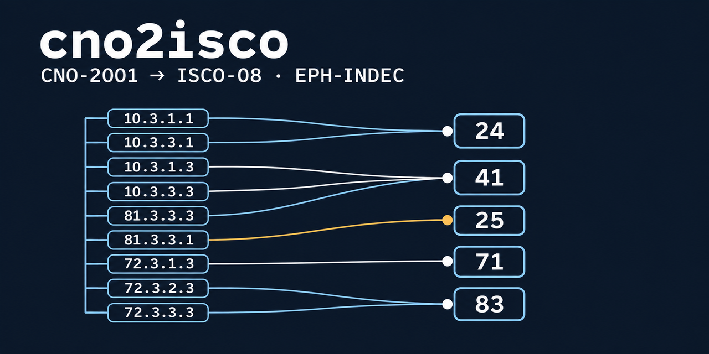

<p align="center"></p>

# cno2isco


> *English:* `cno2isco` adds an ISCO-08 (2-digit) occupation code to the individual microdata of
> Argentina's Permanent Household Survey (EPH-INDEC), starting from the national CNO-2001 code.
> It reads the zip files exactly as published by INDEC and returns a single file with the whole
> series. It builds on INDEC's official correspondence table and documents every additional rule.

La Encuesta Permanente de Hogares codifica la ocupación con el Clasificador Nacional de
Ocupaciones (CNO-2001). Para comparar con otros países, o para usar índices construidos sobre la
clasificación internacional (por ejemplo, los de exposición a la IA de la OIT), hace falta la
**CIUO-08**. `cno2isco` hace esa traducción a 2 dígitos, partiendo de la tabla de
correspondencias del INDEC y completando los casos que la tabla no cubre con reglas explícitas.

---

## 🚀 Uso, paso a paso

**Requisito:** Python 3.9 o superior.

**1. Instalá el paquete** (una sola vez):

```bash
pip install git+https://github.com/juanmanuelbf/cno2isco
```

Si no tenés `git` instalado: en GitHub, *Code → Download ZIP*, descomprimilo y corré
`pip install ./cno2isco-main` desde la carpeta donde quedó.

**2. Armá una carpeta de trabajo** y, adentro, una carpeta llamada `microdatos`:

```
mi_carpeta/
└── microdatos/
```

**3. Descargá los trimestres que quieras** desde la página de bases de datos del INDEC:
[indec.gob.ar → Bases de datos → EPH](https://www.indec.gob.ar/Institucional/Indec/BasesDeDatos).
Bajá la versión en **formato txt**.

**4. Poné los `.zip` en `microdatos/`, sin descomprimir y sin renombrar.** También funciona si ya
los descomprimiste: puede haber `.zip`, `.txt` sueltos o subcarpetas, con cualquier nombre.

**5. Abrí una terminal en `mi_carpeta/` y corré:**

```bash
cno2isco
```

Si los microdatos están en otro lado, indicá la carpeta: `cno2isco "C:\ruta\a\mis\microdatos"`.

**6. Listo.** En `mi_carpeta/` vas a encontrar:

| Archivo | Contenido |
|---|---|
| `eph_isco08.csv` | Todos los trimestres juntos, con todas las variables originales y las columnas nuevas |
| `eph_isco08_cobertura.csv` | Cuántos ocupados quedaron clasificados en cada trimestre, y por qué regla |

> 💡 Si no te funciona el comando `cno2isco`, probá con `python -m cno2isco`.

### Qué vas a ver en la terminal

```
[1/4] Buscando microdatos en C:\...\mi_carpeta\microdatos
      2025T1   EPH_usu_1er_Trim_2025_txt.zip > usu_individual_T125.txt
      --       EPH_usu_1er_Trim_2025_txt.zip > usu_hogar_T125.txt  (omitido: base de hogares (no se usa))
      ...
[3/4] Aplicando la correspondencia
      2025T1    45.425 personas    20.076 ocupados    1.066 desocupados   CIUO a 2 dígitos:  95,6 %
      ...
  Cobertura 2017T1 - 2026T1  (ocupados, % de casos ponderados)
  Clasificación INDEC                              91,77 %     736.210
  Clasificación ad hoc                              6,90 %      47.193
  Sin clasificación                                 1,33 %       7.955
  ...
  CIUO-08 a 2 dígitos                              95,72 %
```

Si algo falla, el mensaje dice en qué archivo y por qué.

---

## 📦 Qué devuelve

El archivo `eph_isco08.csv` mantiene el formato de las bases del INDEC (separador `;`, coma
decimal) y trae a **todas las personas** de **todos los trimestres**, con todas las variables
originales. Cuando el INDEC agregó o quitó variables a lo largo de la serie, los trimestres que no
las tienen quedan con esas celdas vacías.

Se agregan estas columnas para los **ocupados** (a partir de su ocupación principal, `PP04D_COD`)
y para los **desocupados que tuvieron un trabajo anterior** (a partir de esa ocupación,
`PP11D_COD`). Para el resto de las personas quedan vacías.

| Columna | Qué es |
|---|---|
| `cno01_fuente` | De qué variable sale el código: `PP04D_COD` (ocupados) o `PP11D_COD` (desocupados) |
| `cno01_5d` | Código CNO-2001 normalizado a 5 dígitos |
| `cno01_caracter`, `cno01_caracter_desc` | Carácter ocupacional (dígitos 1-2) y su descripción |
| `cno01_jerarquia`, `cno01_tecnologia`, `cno01_calificacion` | Dígitos 3, 4 y 5 del CNO |
| `isco08_2d`, `isco08_2d_desc` | **Subgrupo principal CIUO-08 (2 dígitos)** y su descripción |
| `isco08_gran_grupo`, `isco08_gran_grupo_desc` | Gran grupo CIUO-08 (1 dígito) |
| `isco08_metodo` | Regla que asignó el código (`directo`, `por_actividad`, `vecindad`, ...) |
| `isco08_caso` | Lo mismo, agrupado en 5 categorías para tabular |

### Desde Python

Si ya tenés la base cargada en un `DataFrame`:

```python
import cno2isco

df = cno2isco.cross(df)   # necesita ESTADO, PP04D_COD y PP04B_COD (y PP11D_COD, PP11B_COD para desocupados)
```

---

## 🧭 Cómo funciona (resumido)

1. **Tabla del INDEC.** Si el código CNO está en la tabla oficial de correspondencias, se usa el
   CIUO que indica.
2. **Por actividad.** Para 25 códigos la tabla sólo da el gran grupo; el segundo dígito se
   completa con la rama de actividad, según las tablas auxiliares del INDEC.
3. **Vecindad.** Si el código no está en la tabla, se miran los códigos de igual carácter y
   calificación: si hay al menos dos y todos van al mismo CIUO, se adopta ese.
4. Lo que no se puede resolver queda sólo con el gran grupo o sin clasificar, y se informa.

Con esto, para 2017T1-2026T1 queda clasificado a 2 dígitos el **95,7 %** de los ocupados y el
98,7 % al menos a 1 dígito (casos ponderados). Para los desocupados con ocupación anterior, 95,8 %
y 98,6 %.

- 📐 [Anexo metodológico](docs/metodologia.md)

---

## 📝 Cómo citar

Si usás `cno2isco` en un trabajo, citalo así (también podés usar el botón *Cite this repository*
de GitHub):

> Barreda Fafasuli, J. M. (2026). *cno2isco: correspondencia CNO-2001 a CIUO-08 para la EPH-INDEC*
> (versión 0.1.0). https://github.com/juanmanuelbf/cno2isco

Y la fuente de los datos, como pide el INDEC: *Fuente: INDEC, Encuesta Permanente de Hogares.*

## 📄 Licencia

Código bajo licencia [MIT](LICENSE). Las tablas de `src/cno2isco/datos/` derivan de las
correspondencias publicadas por el INDEC; se distribuyen bajo
[CC BY 4.0](https://creativecommons.org/licenses/by/4.0/deed.es) citando esa fuente.

---

<sub>Autor: Juan Manuel Barreda Fafasuli. ¿Encontraste un error o un caso mal clasificado?
Abrí un [issue](https://github.com/juanmanuelbf/cno2isco/issues).</sub>
